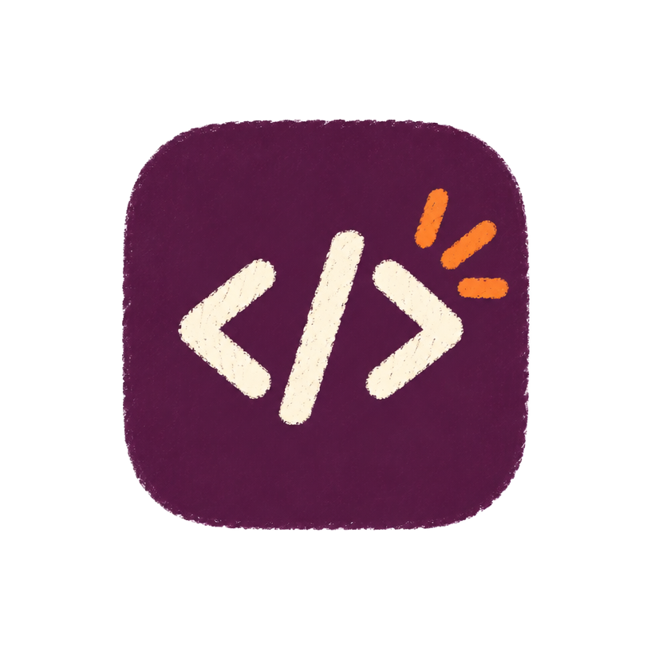
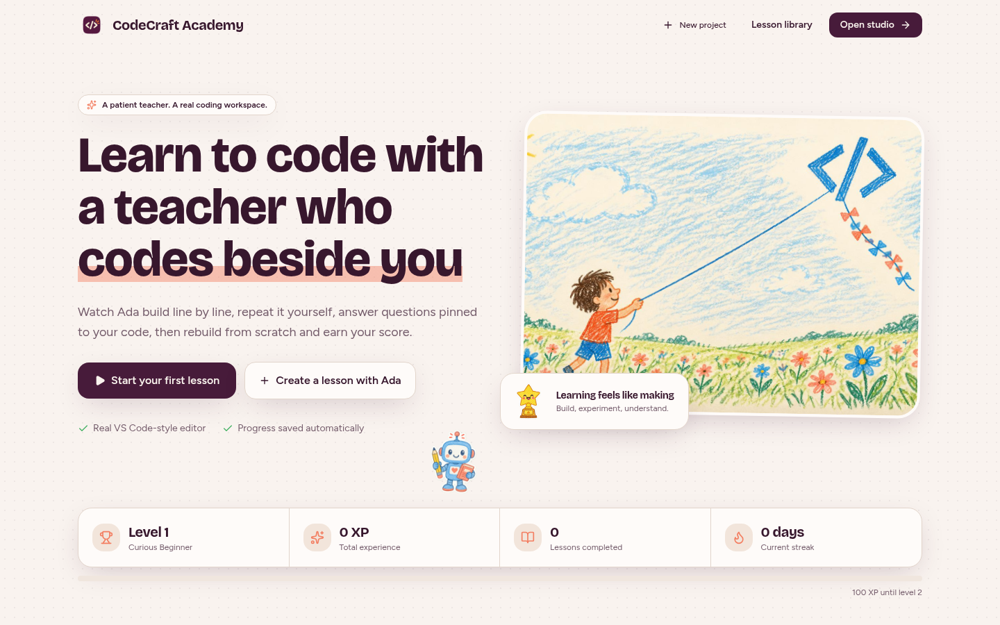
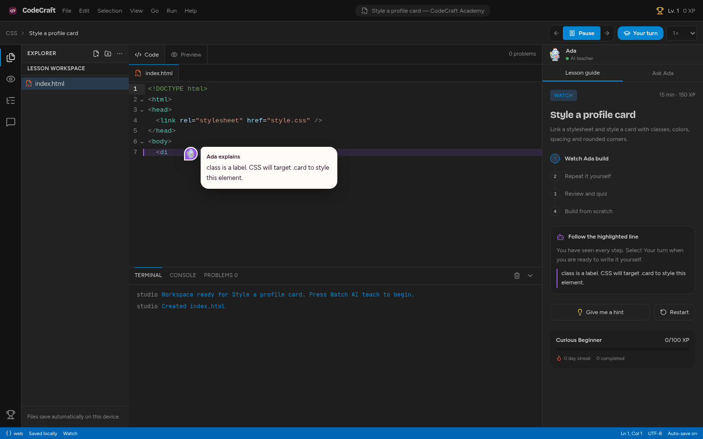
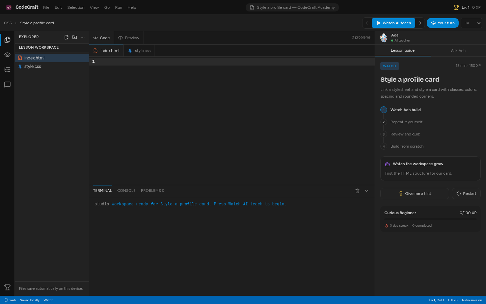
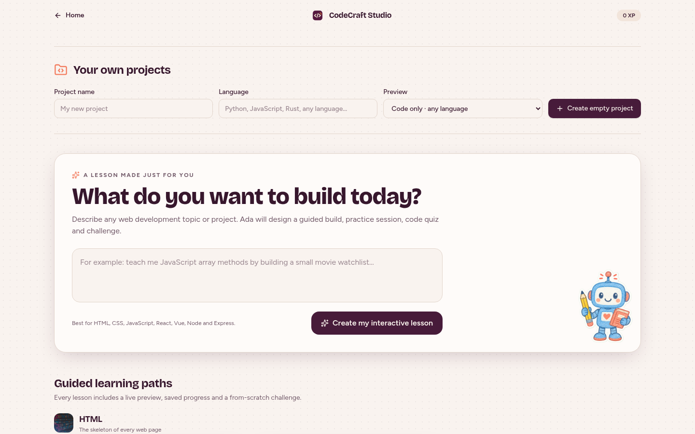
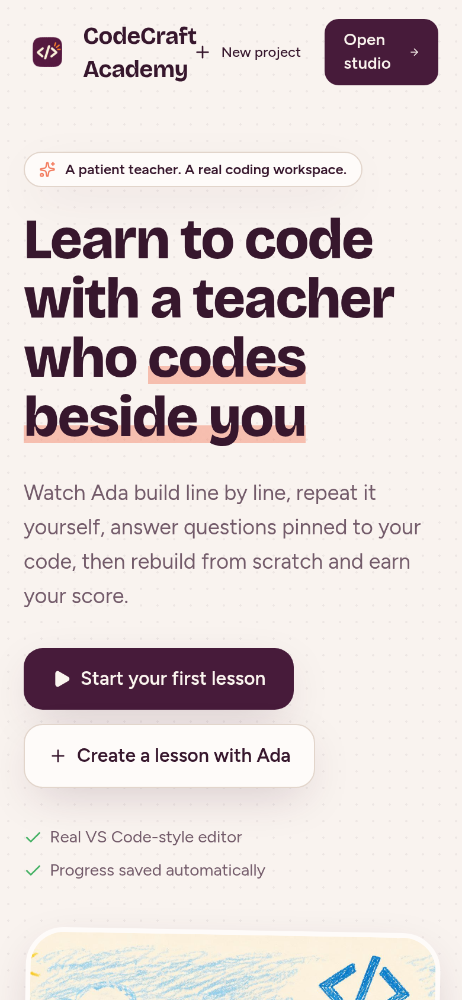

<div align="center">



# CodeCraft Coach Studio

**An AI coding teacher that writes, explains, and grades code inside a VS Code-style workspace.**

Created by **Noubia Bilomia Hance**

### [Try CodeCraft live, free in your browser](https://codecraft-coach-studio.lovable.app)

[](https://codecraft-coach-studio.lovable.app)

[Live app](https://codecraft-coach-studio.lovable.app) ·
[Curriculum](#curriculum) ·
[Features](#features) ·
[Getting started](#getting-started)


</div>

---

## Try it now

**No installation and no account needed.** Open
**[codecraft-coach-studio.lovable.app](https://codecraft-coach-studio.lovable.app)**,
pick a lesson, and Ada starts teaching in seconds. Your progress saves automatically in
your browser, so you can come back any time and continue where you stopped.

If you enjoy it, please star this repository and share the link with a friend who is
learning to code.

## Screenshots

### Landing page
[](https://codecraft-coach-studio.lovable.app)

### Ada teaching a lesson, line by line
Ada types the code herself and pins an explanation bubble on the exact line she is writing.

[](https://codecraft-coach-studio.lovable.app/studio/css/style-a-card)

### VS Code-style coding workspace
[](https://codecraft-coach-studio.lovable.app/studio/css/style-a-card)

### Lesson library
[](https://codecraft-coach-studio.lovable.app/studio)

<p align="center">
  
  <br /><em>Works on phones too.</em>
</p>

## Overview

CodeCraft Coach Studio is an interactive coding school that runs entirely in the browser.
Instead of watching videos, you work in a real editor while an AI teacher named **Ada**
creates files, types code line by line, pins Figma-style comment bubbles onto specific
lines, and then grades what you write yourself.

Every action Ada takes is visible: new folders appear in the file tree, code lands one
line at a time, the preview refreshes, and the terminal shows what happened. When Ada
finishes explaining, you repeat the work from a blank editor and get line-by-line feedback.

## How a lesson works

| Stage | What happens |
| --- | --- |
| **1. Watch** | Ada builds the project in front of you, typing each line and pinning an explanation bubble where it matters. Pause, step, or interrupt at any point. |
| **2. Repeat** | The same files are handed to you blank. You write the code while Ada watches and checks it as you go. |
| **3. Quiz** | Ada pins a question onto an exact line of your code. You answer in the bubble, and Ada marks the answer for meaning, not spelling. |
| **4. Challenge** | You rebuild the lesson from scratch, files and folders included. Ada inspects each line, scores the work, and explains every deduction. |
| **5. Score** | XP, streak, level, and badges are awarded, then saved so you can close the tab and pick up exactly where you left off. |

Still confused? Ada generates a similar exercise, and you can pause the lesson to ask a
question in your own words at any time.

## Features

### Teaching engine

- Live line-by-line code generation with visible file and folder creation
- Figma-style pinned comment bubbles attached to exact code lines
- Interactive questions pinned to a line, answered in place and marked for reasoning
- Automatic follow-up exercises when an answer shows a gap in understanding
- Ask Ada anything mid-lesson, including "why is this line here"
- Personalised lessons generated on request, for example a CSS Flexbox pricing card

### Workspace

- File explorer with nested folders, file and folder creation, selection, and delete
- CodeMirror editor with syntax highlighting, line numbers, and an active-line marker
- Terminal, Console, and Problems tabs
- Connection view that shows how files reference each other
- Language support for HTML, CSS, JavaScript, TypeScript, JSON, Markdown, YAML, SQL,
  Python, Java, C++, and Rust

### Previews

- Cute phone frame with bezel and notch, plus tablet and desktop viewports
- Live rendering for HTML/CSS/JS, React, and Vue projects
- Simulated Node, Express, and full-stack servers with a request panel
- Console error capture and manual refresh

### Your own projects

- Start an empty personal project in any supported language and code freely
- Ask Ada to review the whole project and return corrections you can apply
- Personal work is stored separately from lesson progress and never overwrites a lesson

### Progress and polish

- XP, streaks, levels, badges, trophy dialogs, and confetti
- Save and resume: lesson, stage, current line, and partially typed code are restored
- Unknown URLs redirect home instead of showing a missing-page screen
- Custom browser icon and app identity throughout

## Curriculum

Eight tracks, twelve lessons, beginner to full stack.

| Track | Lessons | Runtime |
| --- | --- | --- |
| HTML | Your first web page; Semantic layout and lists | Web |
| CSS | Style a profile card; Flexbox navigation bar | Web |
| JavaScript | A click counter; Todo list with arrays | Web |
| React | Components and props; State with useState | React |
| Vue | Reactive data and directives | Vue |
| Node | Modules and functions | Node |
| Express | Your first REST API | Express |
| Full stack | Full stack guestbook | Full stack |

Custom lessons generated by Ada appear alongside these in the lesson library.

## Tech stack

| Layer | Choice |
| --- | --- |
| Framework | TanStack Start with TanStack Router, React 19 |
| Build tool | Vite 8 |
| Styling | Tailwind CSS 4, Radix UI primitives, shadcn-style components |
| Editor | CodeMirror 6 with per-language modes |
| AI | Lovable AI Gateway through the Vercel AI SDK, called from server functions |
| Validation | Zod |
| Testing | Vitest with Testing Library |

## Getting started

Requires Node.js 20 or newer.

```sh
git clone <this-repository-url>
cd codecraft-coach-studio
npm install
npm run dev
```

Open the printed local URL, usually `http://localhost:8080`.

### Scripts

| Command | Purpose |
| --- | --- |
| `npm run dev` | Start the dev server with hot reload |
| `npm run build` | Production build |
| `npm run preview` | Serve the production build locally |
| `npm test` | Run the test suite once |
| `npm run test:watch` | Run tests in watch mode |
| `npm run lint` | ESLint over the project |
| `npm run format` | Prettier write pass |

## Project structure

```text
src/
  assets/            logo, hero artwork, stickers
  components/
    ide/             editor, file icons, pinned comment bubbles
    studio/          file explorer, preview pane, terminal, celebration dialog
  lib/
    curriculum.ts    tracks and lesson definitions
    studio.ts        workspace checks, validation, scoring helpers
    runtime.ts       browser preview runners for web, React, Vue, Node, Express
    progress.ts      XP, streaks, badges, save and resume
    projects.ts      personal project storage
    teacher.functions.ts  server-side Ada requests
  routes/
    index.tsx        landing page
    studio.index.tsx lesson library and lesson generator
    studio.$trackId.$lessonId.tsx  the lesson workspace
    projects.$projectId.tsx        personal project workspace
    $.tsx            catch-all redirect home
  test/              routing, studio, and project tests
```

## Testing

```sh
npm test
```

The suite covers route resolution, workspace validation and scoring, preview runtime
behaviour, and personal project storage.

## Author

**Noubia Bilomia Hance** — creator, designer, and maintainer of CodeCraft Coach Studio.

Copyright © 2026 Noubia Bilomia Hance. All rights reserved.

## Visit the app

Everyone is welcome to learn with CodeCraft: **[codecraft-coach-studio.lovable.app](https://codecraft-coach-studio.lovable.app)**

## Acknowledgements

Built with [Lovable](https://lovable.dev), which hosts the live app and keeps this
repository in sync. Original artwork and stickers ship in `src/assets/`.
